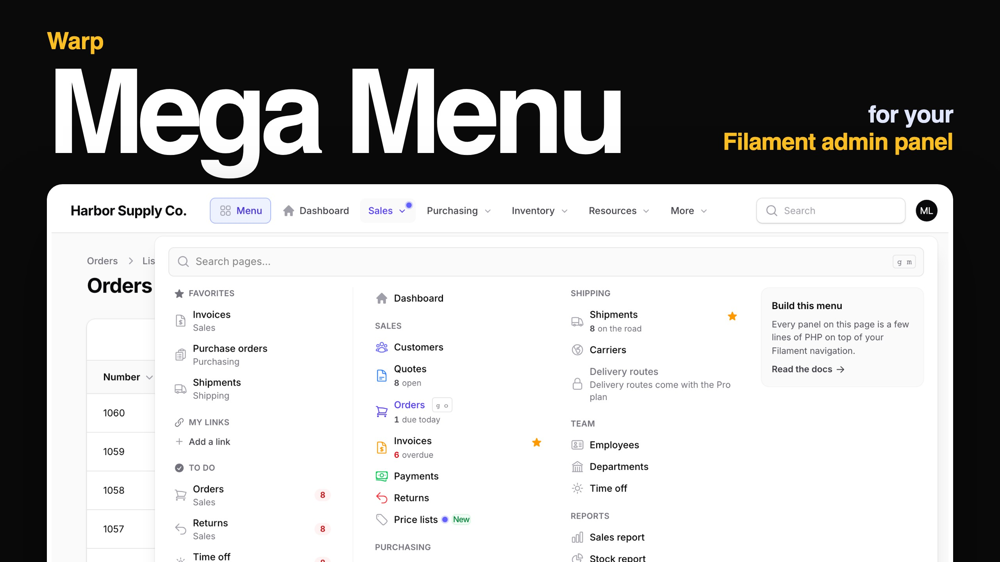

# Warp Mega Menu

**A mega menu for Filament panels with many pages. Your navigation groups open as wide panels with columns, descriptions, coloured icons, live numbers and a promo card — plus a launcher with search, favorites and recently opened pages and records, a sidebar flyout, a full-screen drawer on phones, and an editor so admins can rearrange the menu without a deploy. It works with the navigation you already have: install it and every resource and page is in the menu.**

<a href="https://demo.warpui.com/megamenu"></a>

Open the Sales group, star a page, press <kbd>g</kbd> <kbd>m</kbd> and type *#1042* to jump straight to an order, then rearrange the menu as an admin — at **[demo.warpui.com/megamenu](https://demo.warpui.com/megamenu)**. No sign-up needed; the data is reset every hour.



- [What it does](#what-it-does)
- [Installation](#installation)
  - [AI coding assistants (Laravel Boost)](#ai-coding-assistants-laravel-boost)
- [Quick start](#quick-start)
- [Groups](#groups)
  - [Columns](#columns)
  - [Header, card, view all and create buttons](#header-card-view-all-and-create-buttons)
  - [Bento and flow layouts](#bento-and-flow-layouts)
  - [Plain dropdowns](#plain-dropdowns)
- [Items](#items)
  - [Writing the item next to the resource](#writing-the-item-next-to-the-resource)
  - [External links and actions](#external-links-and-actions)
  - [Item methods](#item-methods)
- [Numbers and badges](#numbers-and-badges)
- [The launcher](#the-launcher)
  - [Search](#search)
  - [Opening a record by its number](#opening-a-record-by-its-number)
  - [Favorites and recently opened](#favorites-and-recently-opened)
  - [Recommended and to do](#recommended-and-to-do)
- [Opening and closing](#opening-and-closing)
  - [Keys that open the panels](#keys-that-open-the-panels)
  - [Opening from an action or your own button](#opening-from-an-action-or-your-own-button)
  - [Keyboard](#keyboard)
- [Sidebar flyout](#sidebar-flyout)
- [Phones](#phones)
- [Letting people change the menu](#letting-people-change-the-menu)
  - [Choosing groups](#choosing-groups)
  - [The menu editor](#the-menu-editor)
- [Menus you make](#menus-you-make)
  - [A button in the panel bar](#a-button-in-the-panel-bar)
  - [On the public pages of your app](#on-the-public-pages-of-your-app)
- [All pages](#all-pages)
- [Tenancy and several panels](#tenancy-and-several-panels)
- [Changing the look](#changing-the-look)
- [Plugin methods](#plugin-methods)
- [Requirements](#requirements)
- [Support](#support)
- [License](#license)

## What it does

Filament's top navigation opens each group as a short list. That is fine for five pages; with thirty, people hunt. Warp Mega Menu keeps your navigation — resources, pages, groups, icons, badges, sort order, permissions — and draws it the way large business apps do:

| You want… | Use |
| --- | --- |
| Groups that open as wide panels, with columns and headings | [`MegaGroup`, `MegaSection`](#groups) |
| A line under each page that says what it is for, coloured icons, *New* tags | [`MegaItem`](#items) |
| *3 overdue*, *12 due today* next to the page, read only when the panel opens | [`->stat()`](#numbers-and-badges) |
| A card for a new feature, a *View all* link, *+ New order* buttons | [`->card()`, `->viewAll()`, `->createButtons()`](#header-card-view-all-and-create-buttons) |
| Quote → Order → Shipment → Invoice drawn as a flow | [`->flow()`](#bento-and-flow-layouts) |
| One place to search every page (and every record), with favorites and recently opened pages | [The launcher](#the-launcher) |
| A row action, a form action or your own button that opens a group's panel | [`->openMegaMenu()`](#opening-from-an-action-or-your-own-button) |
| Type *#1042* and open that order | [`RecordLookup`](#opening-a-record-by-its-number) |
| The same panels from the sidebar, even when it is collapsed to icons | [`->sidebarFlyout()`](#sidebar-flyout) |
| A real menu on phones | [The drawer](#phones) |
| Admins rearrange, rename and hide pages, and add links, without a deploy | [`->editable()`](#the-menu-editor) |
| More menus, made in the editor: a button in the panel bar, or the header of your public site | [Menus you make](#menus-you-make), `<x-warp-megamenu::menu name="site" />` |
| A printable list of every page with its description | [`->sitemap()`](#all-pages) |

And it:

- **needs no configuration.** Install it and switch on `topNavigation()`: every group of your panel opens as a panel with your icons and badges. Add descriptions and columns only where you want them.
- **respects your navigation rules.** Pages people may not open (`canAccess()`, `shouldRegisterNavigation()`, policies) are not shown, in the panels, in search or in the launcher.
- **is quick.** The menu is drawn on the server. Slow numbers are read only when someone opens a group, and the JavaScript (about 5 KB compressed) only opens and closes panels.
- **works with a keyboard and screen readers.** Arrow keys between groups and columns, <kbd>Esc</kbd> to close, focus that returns where it was, and `aria-expanded` on every button.
- **speaks ten languages** (English, Japanese, German, French, Spanish, Italian, Brazilian Portuguese, Korean, simplified and traditional Chinese), and handles right-to-left pages.
- **keeps favorites, recently opened pages and the edited menu per user, per panel and per tenant.**

## Installation

> **Warp Mega Menu is a commercial plugin.** A license is required. After purchase you receive credentials for the private Composer repository.

```bash
composer config repositories.qalainau composer https://qalainau.privato.pub/composer
composer config --auth http-basic.qalainau.privato.pub "your-email" "your-license-key"

composer require qalainau/filament-warp-megamenu
php artisan filament:assets
php artisan migrate
```

> Run `php artisan filament:assets` again after every update of the package.

`php artisan migrate` creates six tables for favorites, recently opened pages, the edited menu and its history, the menus you make and each person's choice of groups and links (`warp_megamenu_favorites`, `warp_megamenu_visits`, `warp_megamenu_layouts`, `warp_megamenu_layout_versions`, `warp_megamenu_menus`, `warp_megamenu_preferences`). Your tables are not changed. To edit the migration, publish it first with `php artisan vendor:publish --tag=filament-warp-megamenu-migrations`.

Register the plugin on the panel, and turn on Filament's top navigation:

```php
use Qalainau\FilamentWarpMegaMenu\FilamentWarpMegaMenuPlugin;

$panel
    ->topNavigation()
    ->plugin(FilamentWarpMegaMenuPlugin::make());
```

Without `topNavigation()` your sidebar stays as it is; the topbar gets the *Menu* button (the [launcher](#the-launcher)), and with [`->sidebarFlyout()`](#sidebar-flyout) the sidebar groups open the same panels.

### AI coding assistants (Laravel Boost)

Warp Mega Menu ships instructions for AI coding assistants such as Claude Code, Cursor and Codex. If your app uses
[Laravel Boost](https://laravel.com/docs/boost), the assistant learns from them how the menu is built from your navigation, which class to use for groups, columns and items, and how to test it.

- **Guidelines** (`resources/boost/guidelines/core.md`): a short summary that Boost adds to `CLAUDE.md`, `AGENTS.md` and the other agent files. It also points the assistant to this README in `vendor/`, so it reads the documentation of the version you have installed.
- **Skill** `warp-megamenu-development` (`resources/boost/skills/`): examples for groups, items, the launcher, the editor and tests. The assistant loads it when it works on the menu.

When `php artisan boost:install` asks "Which third-party AI guidelines/skills would you like to install?", select `qalainau/filament-warp-megamenu`. To do it without the question, add the package to `boost.json` and run the command again:

```json
{
    "packages": ["qalainau/filament-warp-megamenu"]
}
```

```bash
php artisan boost:install --guidelines --skills -n
```

## Quick start

A wholesale app with Sales, Purchasing and Inventory groups. Put the menu in its own class so the panel provider stays short:

```php
namespace App\Filament;

use App\Filament\Resources\Customers\CustomerResource;
use App\Filament\Resources\Invoices\InvoiceResource;
use App\Filament\Resources\Orders\OrderResource;
use App\Filament\Resources\Quotes\QuoteResource;
use App\Models\Invoice;
use Qalainau\FilamentWarpMegaMenu\FilamentWarpMegaMenuPlugin;
use Qalainau\FilamentWarpMegaMenu\Menu\MegaCard;
use Qalainau\FilamentWarpMegaMenu\Menu\MegaGroup;
use Qalainau\FilamentWarpMegaMenu\Menu\MegaItem;
use Qalainau\FilamentWarpMegaMenu\Menu\MegaSection;
use Qalainau\FilamentWarpMegaMenu\Menu\RecordLookup;

class Menu
{
    public static function plugin(): FilamentWarpMegaMenuPlugin
    {
        return FilamentWarpMegaMenuPlugin::make()
            ->groups([
                MegaGroup::make('Sales')                       // the navigationGroup of your resources
                    ->description('From the first quote to the paid invoice.')
                    ->sections([
                        MegaSection::make('Selling')->items([
                            MegaItem::resource(CustomerResource::class)->description('Companies you sell to'),
                            MegaItem::resource(QuoteResource::class)->description('Prices waiting for a yes'),
                            MegaItem::resource(OrderResource::class)->description('Orders to pick and ship'),
                        ]),
                        MegaSection::make('Billing')->items([
                            MegaItem::resource(InvoiceResource::class)
                                ->description('Bills sent to customers')
                                ->stat(fn (): int => Invoice::overdue()->count(), 'overdue'),
                        ]),
                    ])
                    ->card(MegaCard::make('New: price lists')->body('Give each customer group its own prices.')->url('/admin/price-lists'))
                    ->createButtons([QuoteResource::class, OrderResource::class]),
            ])
            ->recordLookups([
                RecordLookup::make(OrderResource::class)->column('number')->prefix('#'),
            ]);
    }
}
```

```php
$panel->topNavigation()->plugin(\App\Filament\Menu::plugin());
```

Every resource and page you did not mention is still in the menu, in the group Filament puts it in.

## Groups

`MegaGroup::make()` takes the same value you give `$navigationGroup` on your resources and pages — a string, or a case of your navigation group enum. It adds to that group; a name that Filament does not have creates a new group.

```php
use App\Enums\NavigationGroup;

MegaGroup::make('Sales'),
MegaGroup::make(NavigationGroup::Inventory),   // enum groups work too
MegaGroup::make('Help')->items([...]),          // a new group that only the menu has
```

The order of the groups is Filament's (`$panel->navigationGroups([...])`).

> With an enum that implements `HasLabel`, the menu reads the group's label from the enum each time it is drawn, so it follows the user's language. Filament's own `$panel->navigationGroups(NavigationGroup::class)` reads the labels once, when the panel is built — before the language is set — so its sidebar would stay in the default language. If you also show the sidebar, register the groups with closures instead: `->navigationGroups(collect(NavigationGroup::cases())->mapWithKeys(fn ($group) => [$group->name => \Filament\Navigation\NavigationGroup::make(fn () => $group->getLabel())])->all())`. Change it with `->sort()`, rename a group with `->label()`, give it an icon with `->icon()`, and hide it with `->hidden()` or `->visible(fn (): bool => ...)`.

### Columns

Without sections, a group's pages are listed in one column, in Filament's order. `->sections()` splits the panel into columns with headings:

```php
MegaGroup::make('Sales')->sections([
    MegaSection::make('Selling')->items([CustomerResource::class, QuoteResource::class, OrderResource::class]),
    MegaSection::make('Billing')->items([InvoiceResource::class, PaymentResource::class]),
    MegaSection::make('Setup')->items([PriceListResource::class])->divider(),
]),
```

- **Items** are `MegaItem`s or just the resource and page classes.
- **A page you list moves here**, even from another group. Pages of the group that no section lists go into a column without a heading at the end — or into the section you mark with `->other()`.
- **Columns:** the panel has as many columns as sections (at most 4). Change it with `MegaGroup::columns(3)`. A section can span several columns (`->span(2)`), and list its own items in columns (`->columns(2)`) when it is long.
- **Width:** panels are `64rem` wide, or the window minus a margin. Change it for one group with `->width('48rem')`, or for all with the plugin's `->panelWidth()`.
- Sections take `->description()` and `->visible()` too.

### Header, card, view all and create buttons

```php
MegaGroup::make('Sales')
    ->description('From the first quote to the paid invoice.')    // under the group name, at the top of the panel
    ->viewAll(OrderResource::class, 'All orders')                 // a link at the top right; a resource class or any URL
    ->card(
        MegaCard::make('New: price lists')
            ->body('Give each customer group its own prices.')
            ->image(asset('images/price-lists.png'))
            ->url(fn (): string => PriceListResource::getUrl())
            ->button('Try it')
            ->color('success'),                                   // any Filament colour
    )
    ->createButtons([QuoteResource::class, OrderResource::class]); // "+ New quote", "+ New order" at the bottom
```

`createButtons()` takes resource classes (their *create* page, only for people who may create) or `MegaItem`s.

Every resource item also gets a small **+** next to it, linking to its create page, when the resource has one and the user may create. Turn it off with the plugin's `->createLinks(false)`, or for one item with `->createUrl(false)`.

### A small chart

```php
use Qalainau\FilamentWarpMegaMenu\Menu\MegaChart;

MegaGroup::make('Sales')
    ->chart(
        MegaChart::make('Orders this week')
            ->data(fn (): array => collect(range(0, 4))                        // ['Mon' => 4, 'Tue' => 7, …]
                ->mapWithKeys(fn (int $day): array => [
                    now()->startOfWeek()->addDays($day)->translatedFormat('D') => Order::query()->whereDate('created_at', now()->startOfWeek()->addDays($day))->count(),
                ])
                ->all())
            ->total(fn (array $data): string => array_sum($data).' orders') // true (the sum, default), false or your own text
            ->color('success'),
    )
```

A small bar chart with its total, under the title of the panel. The data is read only when the panel opens (and again with `->poll()`), like the numbers of the items. Values that are not numbers are left out.

### Bento and flow layouts

```php
MegaGroup::make('Inventory')
    ->bento()                       // boxes of different sizes
    ->columns(3)
    ->items([
        MegaItem::resource(ProductResource::class)->span(2)->image(asset('images/shelves.jpg')),
        MegaItem::resource(CategoryResource::class),
    ]),

MegaGroup::make('Purchasing')
    ->flow()                        // Supplier → Purchase order → Goods receipt → Bill
    ->items([
        MegaItem::resource(SupplierResource::class),
        MegaItem::resource(PurchaseOrderResource::class)->stat(fn (): int => PurchaseOrder::toSend()->count(), 'to send'),
        MegaItem::resource(GoodsReceiptResource::class)->stat(fn (): int => GoodsReceipt::arriving()->count(), 'arriving'),
        MegaItem::resource(SupplierBillResource::class),
    ]),
```

In a flow, the items are drawn left to right with arrows between them, and their numbers under each step — a quick look at where work is waiting.

### Plain dropdowns

A group with three settings pages does not need a big panel:

```php
MegaGroup::make('Settings')->dropdown(),
```

Groups without a name (Filament's ungrouped pages, like the dashboard) are links in the bar.

## Items

`MegaItem::resource()` and `MegaItem::page()` add to the item Filament already has for that resource or page. They keep its label, icon, URL, badge and permissions, and add what you write:

```php
MegaItem::resource(InvoiceResource::class)
    ->description('Bills sent to customers')
    ->iconColor('warning')                    // puts the icon in a coloured box
    ->keywords(['bill', 'billing'])           // found when people search for these words
    ->stat(fn (): int => Invoice::overdue()->count(), 'overdue', fn (int $value): string => $value > 0 ? 'danger' : 'gray')
    ->tag('New', 'success')
    ->new('2026-12-31', 'success')            // a dot until the person opens it, or until that day (colour optional)
    ->helpUrl('https://docs.example.com/invoices'),
```

Write items inside a group's `->sections()` / `->items()`, or anywhere with the plugin's `->items([...])` — handy for descriptions, when the columns are fine as they are:

```php
FilamentWarpMegaMenuPlugin::make()->items([
    MegaItem::resource(OrderResource::class)->description('Orders to pick and ship'),
    MegaItem::page(SalesReport::class)->description('Revenue by month and customer'),
]);
```

Every method takes a closure. Closures run when the menu is drawn — after the user's language is set — so `fn (): string => __('menu.orders')` shows each person their language.

### Writing the item next to the resource

If you prefer to keep the description with the resource, implement `HasMegaMenuItem`:

```php
use Qalainau\FilamentWarpMegaMenu\Menu\HasMegaMenuItem;
use Qalainau\FilamentWarpMegaMenu\Menu\MegaItem;

class OrderResource extends Resource implements HasMegaMenuItem
{
    public static function megaMenuItem(MegaItem $item): MegaItem
    {
        return $item
            ->description('Orders to pick and ship')
            ->stat(fn (): int => Order::dueToday()->count(), 'due today');
    }
}
```

### External links and actions

```php
MegaItem::external('Status page', 'https://status.example.com'),   // new tab, with an arrow icon

MegaItem::make('Wiki')->url('https://wiki.example.com')->icon('heroicon-o-book-open'),

MegaItem::action(
    Action::make('feedback')
        ->label('Send feedback')
        ->icon('heroicon-o-chat-bubble-left-ellipsis')
        ->schema([Textarea::make('message')->required()])
        ->action(fn (array $data) => Feedback::create($data)),
),
```

`MegaItem::action()` takes any Filament action, with its modal, form, confirmation and `->visible()`. The menu closes when the modal opens.

### Item methods

| Method | What it does |
| --- | --- |
| `MegaItem::resource($class, $page = 'index')` | The resource's page. Adds to Filament's item if there is one. |
| `MegaItem::page($class)` | A Filament page. |
| `MegaItem::make($label)->url($url)` | Any link. |
| `MegaItem::external($label, $url)` | A link that opens in a new tab. |
| `MegaItem::action(Action $action)` | Runs a Filament action. |
| `->label()`, `->icon($icon, $color)`, `->url()` | Change what Filament shows. |
| `->iconColor('primary')` | The icon in a coloured box (`primary`, `success`, `warning`, `danger`, `info`, `gray` or your panel's colours). |
| `->description()` | A line under the name. Also used by search. |
| `->badge($value, $color)` | A badge. Without it, Filament's `getNavigationBadge()` is used. |
| `->stat($value, $label, $color)` | A small number under the name, read when the panel opens. See [Numbers and badges](#numbers-and-badges). |
| `->tag('Beta', 'warning')` | A small tag next to the name. |
| `->new($until, $color = 'primary')` | A dot on the item and its group until the person opens the page, or until the date. `$color` is `primary`, `success`, `warning`, `danger`, `info` or `gray`; the group's dot takes the colour of its first new item. |
| `->keywords([...])` | Other words search should find it by. |
| `->shortcut('g o')` | Keys that jump to the page from anywhere: a sequence (`g` then `o`) or keys pressed together (`mod+shift+o`, where `mod` is ⌘ on a Mac and Ctrl elsewhere). Shown next to the name. |
| `->locked($condition, $url, $label)` | A lock instead of the icon; the item links to `$url` (your pricing page). |
| `->helpUrl($url)` | A **?** next to the item, opening your manual. |
| `->todo(fn (): int => ...)` | The count for the launcher's *To do* list. See [Recommended and to do](#recommended-and-to-do). |
| `->createUrl($url, $label)` | The **+** next to the item. `false` removes it. |
| `->span(2)`, `->image($url)` | Size and picture in a bento group. |
| `->children([...])` | Sub-items, listed under the item. Filament's child items (`$navigationParentItem`) show this way too. |
| `->openUrlInNewTab()`, `->activeWhen(fn () => ...)`, `->sort()`, `->key()` | Same as Filament's navigation items. |
| `->visible()`, `->hidden()` | Hide the item for some people. |

## Numbers and badges

Badges come from Filament (`getNavigationBadge()`, `getNavigationBadgeColor()`), and are shown in the panels and the launcher.

`->stat()` is for numbers that would slow down every page if Filament's badge computed them. They are read **only when a group is opened**, all of that group's numbers in one request, and kept for 30 seconds:

```php
MegaItem::resource(OrderResource::class)
    ->stat(fn (): int => Order::whereDate('ship_on', today())->count(), 'due today'),

MegaItem::resource(InvoiceResource::class)
    ->stat(
        fn (): int => Invoice::overdue()->count(),
        'overdue',
        fn (int $value): string => $value > 0 ? 'danger' : 'gray',   // the colour can depend on the value
    ),
```

The value can be a number (written the way the user's language writes numbers: *1,234*, *1.234*, *1 234*) or any string (*$12.4k*).

Plugin settings for numbers:

```php
FilamentWarpMegaMenuPlugin::make()
    ->poll('30s')                     // re-read the open group's numbers and badges every 30 seconds (never faster than 5 s)
    ->zeroBadges(ZeroBadges::Dim);    // Show (default), Dim or Hide badges and numbers that are 0
```

Polling stops while the browser tab is hidden.

## The launcher

The *Menu* button at the start of the bar (or <kbd>g</kbd> then <kbd>m</kbd>) opens one panel with everything:

- a search box,
- **Favorites**, **My links**, **To do**, **Recommended**, **Recently opened** pages and **Recent records** on the left,
- every group and page on the right.

At the bottom: *Choose groups*, *All pages* and *Edit the menu* (when you turn them on), and *Clear recent*.

```php
FilamentWarpMegaMenuPlugin::make()
    ->launcher(true, 'Menu')                                     // false removes the button
    ->launcherCard(MegaCard::make('Webinar on Thursday')->url('https://example.com/webinar', openInNewTab: true))
    ->shortcut('g m');                                           // or 'mod+k' (⌘K on a Mac, Ctrl+K elsewhere); false for none
```

The button sits at the start of the bar, after the logo. To put it at the right end of the bar, just before the search box and the user menu:

```php
->launcherPosition('end')   // 'start' (default) or 'end'; a closure works too
```

Its panel then opens toward the left, under the button. This is for the top bar; with the sidebar flyout and no top bar, the button stays in the sidebar. To open the launcher from somewhere else — a page header, a widget — use [an action or your own button](#opening-from-an-action-or-your-own-button).

### Search

The search box finds pages by name, description, keywords and group, ignoring upper and lower case, accents (*cafe* finds *Café*), full-width and half-width characters, and katakana and hiragana (*すとっく* finds *ストック*). Pages whose names start with the word come first. <kbd>↓</kbd> goes to the results, <kbd>Enter</kbd> opens the first one.

When the panel has Filament's global search, the box also shows matching **records** under the pages (the same results as Filament's search). Turn it off with `->globalSearch(false)`. When nothing is found, the box says so, suggests a shorter word, and shows the links you give it:

```php
->notFoundLinks([MegaItem::external('Ask support', 'mailto:support@example.com')->icon('heroicon-o-lifebuoy')])
```

**Actions**: the box also finds the create pages — *New order*, and the buttons under the panels — under *Actions*, by the page's name or by words like *new* and *create* (in every language of the plugin).

When the box is empty, it shows the person's **recent searches** (the last five, kept in their browser), to search again with one click.

Turn the whole search off with `->search(false)`.

### Opening a record by its number

People often know the number: *#1042*, *INV-2026-0042*. With a record lookup they type it and press <kbd>Enter</kbd>:

```php
use Qalainau\FilamentWarpMegaMenu\Menu\RecordLookup;

->recordLookups([
    RecordLookup::make(OrderResource::class)->column('number')->prefix('#'),           // "#1042"
    RecordLookup::make(InvoiceResource::class)->column('number')->pattern('/^INV-\d+$/i'), // "inv-2026" too
    RecordLookup::make(CustomerResource::class)->queryUsing(
        fn (Builder $query, string $value) => $query->where('code', $value)->orWhere('phone', $value),
    ),
])
```

- The record is looked up through the resource's `getEloquentQuery()`, so tenancy and your own scopes apply.
- It opens the *view* page if the user may view the record, else the *edit* page (`->page('edit')` to choose). People who may do neither see nothing.
- `->prefix()` is removed before searching; `->pattern()` keeps what was typed. Case does not matter.

### Favorites and recently opened

Everyone can star pages (the ★ appears next to an item on hover, and always on touch screens). Favorites are listed at the top of the launcher, are saved in the database — so they follow people to their phone — and are kept per panel and per tenant.

The launcher also lists the pages and the records (from a resource's view and edit pages) each person opened last. They are recorded by a small middleware the plugin adds to the panel, only for full page loads.

```php
->favorites(false)        // no stars
->recentPages(8)          // how many recent pages (default 6); false for none
->recentRecords(false)    // no recent records
->recordVisits(false)     // do not record anything (also turns off the "new" dots)
```

### Recommended and to do

```php
->recommended(fn (User $user): array => match ($user->role) {
    'accounting' => [InvoiceResource::class, PaymentResource::class, CashFlow::class],
    'warehouse' => [ProductResource::class, StockCountResource::class],
    default => [],
}, 'For your role')
```

Give `->todo()` to the items that have work waiting. The launcher lists the ones with a count above 0, largest first:

```php
MegaItem::resource(OrderResource::class)->todo(fn (): int => Order::waitingForApproval()->count()),
MegaItem::resource(ReturnRequestResource::class)->todo(fn (): int => ReturnRequest::open()->count()),
```

Turn the list off with `->todoList(false)`.

The pages many people open can be added after the recommended ones by themselves:

```php
->autoRecommended(3)   // the 3 pages most people opened in the last 30 days, among those the person may open
```

It can also be turned on and off in the editor (the *Menu* tab).

### My links

Each person can add their own links — the bank, a carrier's tracking page — under *My links* in the launcher, and remove them again. Only `https://`, `http://`, `mailto:`, `tel:` and `/` addresses are kept, up to 20 per person, per panel and tenant.

### A tour for new people

```php
->onboarding()
```

The first time someone opens a page, three small bubbles show how the menu works: the *Menu* button, the shortcut to search (<kbd>g</kbd> <kbd>m</kbd>), and the groups with the ★. It is shown once per person and browser; add `?tour` to a page's address to show it again.

## Opening and closing

Panels open on click. To open them when the mouse rests on a group:

```php
use Qalainau\FilamentWarpMegaMenu\Enums\OpenOn;

->openOn(OpenOn::Hover, delay: 150)   // milliseconds the mouse must rest; passing over does not open
```

With a panel open, moving to the next group switches at once. Panels close when you click outside, press <kbd>Esc</kbd>, or open a page. On touch screens they always open on tap.

### Keys that open the panels

Outside a text box, <kbd>g</kbd> then a number opens a group's panel: <kbd>g</kbd> <kbd>1</kbd> the first group of the bar, <kbd>g</kbd> <kbd>2</kbd> the second, up to <kbd>g</kbd> <kbd>9</kbd> (menus made in the editor count too, after the groups). The focus goes to the first page, so <kbd>↓</kbd> and <kbd>Enter</kbd> open a page without the mouse. A group that does not fit opens from *More*. Resting the mouse on a group button shows its keys.

```php
MegaGroup::make('Sales')->shortcut('g s');   // your own keys for this group; 'mod+shift+s' works too

FilamentWarpMegaMenuPlugin::make()
    ->groupShortcuts(false);                 // no g 1 – g 9 (keys set with ->shortcut() still work)
```

<kbd>g</kbd> <kbd>m</kbd> opens the *Menu* panel ([The launcher](#the-launcher)), and pages can have their own keys too (`MegaItem::shortcut()`, [Items](#items)). The numbers follow the order of the bar, so they change when someone hides or moves groups for themselves.

```php
use Qalainau\FilamentWarpMegaMenu\Enums\Animation;

->animation(Animation::Slide)   // Fade (default), Slide or None. Nothing moves for people who ask their system for less motion.
```

When the groups do not fit in the bar, the last ones move into a *More* button. Turn it off with `->overflowMenu(false)`.

### Opening from an action or your own button

Any Filament action can open a group's panel: a table row action, a form action, a page header action.

```php
use Filament\Actions\Action;

Action::make('salesPages')
    ->label('Sales pages')
    ->icon('heroicon-m-squares-2x2')
    ->openMegaMenu('group:sales');   // nothing (or null) opens the launcher
```

The panel opens as if the person had clicked the group in the bar, with the focus on its first page, so <kbd>↓</kbd> and <kbd>Enter</kbd> work. The click on the action does not close it again. The action does not call Livewire and opens no modal.

| `openMegaMenu(…)` | Opens |
| --- | --- |
| nothing or `null` | The launcher (the *Menu* panel), with the search box ready |
| `'group:sales'` | The group with this key (the same keys as in `MegaMenuRenderHook` scopes and the editor's `?group=`) |
| `'Sales'` | The same group: a name becomes `'group:'` and its slug |
| `NavigationGroup::Sales` | The group made from this enum (its key is `'enum:App\Enums\NavigationGroup::Sales'`) |
| `'menu:help'` | A [menu you made](#menus-you-make) that shows as a button in the bar |

Where it opens:

- under the group's button in the bar. A group that went into *More* opens from *More*;
- beside the group in the sidebar, with [`->sidebarFlyout()`](#sidebar-flyout);
- on screens narrower than 1024 px, the [drawer](#phones) opens, since the groups are in it.

A group the person cannot see (no permission, or hidden for their role) opens nothing, and the browser console says which key was not found. When the launcher is turned off with `->launcher(false)`, opening it does nothing either.

From your own HTML — a Blade view, a widget, a render hook — send the browser event `warp-megamenu-open` with the same values:

```blade
<button type="button" x-data x-on:click="$dispatch('warp-megamenu-open', { group: 'group:sales' })">
    Sales pages
</button>
```

```js
window.dispatchEvent(new CustomEvent('warp-megamenu-open', { detail: { group: 'group:sales' } }))   // detail: {} opens the launcher
```

Here the key must be written out (`'group:sales'`, `'enum:…'`, `'menu:help'`) or be the group's name exactly as it shows. The event works on panel pages with the menu; the components for public pages (`<x-warp-megamenu::menu>`) do not listen to it.

### Keyboard

| Key | On a group button | Inside a panel |
| --- | --- | --- |
| <kbd>→</kbd> / <kbd>←</kbd> | Next / previous group (switches the open panel) | Nearest item in the next / previous column |
| <kbd>↓</kbd> / <kbd>↑</kbd> | Open the panel at the first / last item | Next / previous item |
| <kbd>Home</kbd> / <kbd>End</kbd> | First / last group | First / last item |
| <kbd>Esc</kbd> | — | Close, back to the group button |
| <kbd>g</kbd> <kbd>m</kbd> | Open the launcher with the search box ready (anywhere on the page, except while typing) | |

In right-to-left languages the arrow keys follow the reading direction.

## Sidebar flyout

Keep Filament's sidebar and open the panels from it:

```php
$panel
    ->sidebarCollapsibleOnDesktop()
    ->plugin(FilamentWarpMegaMenuPlugin::make()->sidebarFlyout());
```

- The sidebar lists **only the groups** (Sales, Purchasing, …) instead of every page, like the topbar. Pages without a group, like the dashboard, stay links. The group of the current page is marked.
- Clicking a group (or resting on it, with `->openOn(OpenOn::Hover)`) opens its panel next to the sidebar, level with the group; you open pages from the panel. Click it again, press <kbd>Esc</kbd> or click outside to close it.
- **Collapsed to icons**, resting on a group's icon opens its panel (the icon is the group's icon, or the icon of its first page). Filament's name bubbles are not shown, and a panel opened this way closes when the pointer leaves it.
- <kbd>→</kbd> on a group opens the panel and moves into it.

To keep Filament's list of pages and open the panels from the group names (and, collapsed, from any page icon), pass `groupsOnly: false`:

```php
FilamentWarpMegaMenuPlugin::make()->sidebarFlyout(groupsOnly: false)
```

## Phones

Below 1024 px, Filament's sidebar button is replaced by a menu button that opens a full-screen drawer: the search, favorites, and each group as a section you open and close (the group of the current page is open). Turn it off with `->mobileDrawer(false)` to keep Filament's sidebar.

## Letting people change the menu

### Choosing groups

*Choose groups* in the launcher lets each person untick the groups they never use, and put the others in their own order with ↑ ↓. It changes only their own menu (saved per user, panel and tenant), and nobody can hide every group. Turn it off with `->userCustomization(false)`.

### The menu editor

```php
->editable(fn (User $user): bool => $user->is_admin)   // or just ->editable()
```

People allowed see *Edit the menu* at the bottom of the launcher; it opens the editor on the *Menu* tab (the launcher itself). To link to another tab, add `?group=` with a group key, like `EditMegaMenu::getUrl(['group' => 'group:sales'])`. The page shows the menu the way it will look: the groups as tabs, and the open group drawn with the same panel as the bar. Click a page, the link at the top right or the card in the panel to change just that on the right; click an empty spot of the panel for the settings of the group. Every change shows in the panel as you type, before you save.

- **Rename** pages and groups, **change descriptions and icons** (pick from every Heroicon, outline or solid, searched by name — or type any icon name, like `heroicon-o-truck`), and give a group a description under its name (empty it to show none),
- **change the tag** next to a page name (like *New*): its text and colour, or empty it to show no tag,
- **add other names** a page is found by in the search box (*sales, deals*), next to its `->keywords()`,
- **give a page a shortcut** (`g o`) — the editor warns when another page already uses the keys,
- **colour the number** of a page by rules: *from 10, red*; the number takes the colour of the highest rule it reaches (pages with a `->stat()` only),
- **add, change or remove the “new” dot** next to a page name (from `->new()`): the last day it shows and its colour — click the dot in the panel. In menus you make the dot shows to everyone until that day (they do not remember who opened a page),
- **change the link at the top right** of a panel (from `->viewAll()`) — click it in the panel —, add one to any group (*Add a link at the top right* under the panel), or remove it,
- **change, add or remove the card** of a panel: heading, text, button, address, picture and format — click the card in the panel, or *Add a card* under the panel,
- **add buttons under a panel** (*Add a button under the panel*): to the create page of a resource (shown only to people who may create) or to an address; **rename, hide or move** them, also the ones from `->createButtons()` — click one in the panel,
- **drag** pages into a different order or column, and **move** them to another group: drag one from *Pages of this panel* under the panel (it lists every page with the group it is in; click one to put it at the end of the first column — a hidden page shows again), or use the *Place* list (that works with the keyboard and screen readers too),
- **format** every part on its own: the whole panel (background, text colour, font), the title, the description, each column heading, the name and the description of each page, the card, each button under the panel (background, text colour, font, size, bold, italic, underline). Click a heading or the title in the panel to open its format,
- **add groups** of your own: *Add a group* next to the tabs opens four templates — *Columns* (two columns with headings), *Columns and a card*, *Tiles* (like `->bento()`) and *Steps with arrows* (like `->flow()`). The new group starts empty: drag pages into it from *Pages of this panel*, or add links. You can rename it, change its shape and its columns, and remove it — its pages then go back to the groups they came from. An added group with nothing in it is not shown in the bar,
- **change the panel of the *Menu* button** (the launcher) on its own tab, the first one: the name of the button; the heading, order and visibility of each part of the left column (favorites, to-do, recommended, recently opened pages and records); the pages recommended to everyone — click or drag them in from *Pages of this panel*, before the ones from `->recommended()`; and the card (from `->launcherCard()`) — change it, add one or remove it,
- **move** groups left and right,
- **hide** pages and groups (hidden pages stay in the editor, faded),
- **add links** to other websites or to pages of the app: *Add a link* puts a new link at the end of the group, then type its name and address on the right (only `https://`, `http://`, `mailto:`, `tel:` and `/` addresses; the menu is not saved while a link has no address),
- **see how pages are used**: *Show usage (30 days)* puts next to each page how many people opened it in the last 30 days, and lists the pages nobody opened — click one to open its settings,
- **preview as someone else**: search a person by name or email; the preview is then built with their permissions (pages they may not open are left out), and the editor says which role's menu they get,
- **undo** all changes.

The edited menu is saved in `warp_megamenu_layouts`, once per panel (and per tenant and role). It is laid over the menu you wrote in code: pages you add to the app later show up at the end of their group, and permissions still apply — hiding a page in the editor never shows it to someone who may not open it. *Undo all changes* deletes the saved layout.

### Menus per role

```php
->audience('sales', 'Sales team', fn (User $user): bool => $user->hasRole('sales'))
->audience('warehouse', 'Warehouse', fn (User $user): bool => $user->hasRole('warehouse'))
```

The editor gets a *Menu for* list: *Everyone*, *Sales team*, *Warehouse*. A role starts from everyone's menu; once saved it becomes that role's own menu. People get the menu of the first role they belong to, or everyone's. *Undo all changes* on a role deletes its menu, and its people see everyone's menu again.

### History and publishing later

Every save keeps a version. *History* lists them — when, by whom, which one is live — and *Go back to this* saves an older one again as the newest (going back to *Undone* works too).

*Publish later* saves the menu for a date and time: until then the bar keeps the current menu, and at that time everyone gets the new one. There is no scheduled job — the menu switches the first time it is read after that time. The editor shows the pending change, and *History* can cancel it.

### Export and import

*Export / import → Export to a file* downloads everyone's and every role's menu and the menus you made, as one JSON file. *Import from a file* reads it into another panel, tenant or environment: the layouts are saved again (so the old ones stay in *History*), and made menus are replaced by their name in the code.

### Names in other languages

```php
->editorLocales(['en' => 'English', 'ja' => '日本語'])
```

The editor gets a *Names in* list. Choose a language and type the names and descriptions of pages and groups in it; the original stays as the placeholder, and under the field once you have typed. People see the names of their language (`app()->getLocale()`), and the original where none was typed.

The list works for [menus you make](#menus-you-make) too, so one menu can serve a site in several languages. There you can type, per language, every text people read: the menu's name (the phone button and screen readers), the names and descriptions of groups and links, column headings, tags, the card's title, text and button, the link at the top right and the buttons under the panel. The preview and the group tabs switch to the language you chose. Addresses, icons, colours and layout are shared by all languages. A public page shows the texts of `app()->getLocale()`, so set the locale before the view renders (for example in a middleware that reads the visitor's choice):

```blade
{{-- English visitors see "Products", Japanese visitors see "製品" --}}
<x-warp-megamenu::menu name="site" />
```

Texts typed per language are saved with the menu (in its `structure`, under `translations`) and travel with *Export / import*. Removing a link removes its texts in every language; empty fields are not saved.

## Menus you make

The menu built from your navigation is one menu. In *Edit the menu* you can also make **any number of other menus** — *New menu* at the top of the editor. A menu you make has groups (added from the same templates), columns, links and cards, all edited on the live panel like above. A link goes to a web address or to a page of the panel (shown only to people who may open that page). Under the menu, *Pages of this panel* lists every page you may open: drag one into a column, or click it to add it at the end of the first column.

A card can show a picture (in the panel menu too): choose one in the card's settings and it is stored on the `public` disk in `warp-megamenu/` (change it with `->imageDisk('s3', 'menus')`; the disk must give public URLs — run `php artisan storage:link` for `public`).

A group can also have buttons under its panel, like *New order* or *Call us*, a link at the top right and tags with a colour — the same as in the panel menu.

Each menu has a name in the code (`site`, `help`). The editor shows the line that places it.

### Items made from data

```php
use Qalainau\FilamentWarpMegaMenu\Menu\MegaSource;

->menuSources([
    MegaSource::make('categories', 'Product categories')
        ->items(fn (): iterable => Category::query()->orderBy('name')->get()->map(fn (Category $category): array => [
            'label' => $category->name,
            'url' => route('shop.category', $category),
            'description' => $category->tagline,   // optional, like 'icon'
        ]))
        ->limit(12),
])
```

In a menu you make, an item's *Link to* can then be *Made from data*: choose the source and how many to show. Each time the menu shows, the item becomes one link per row — new categories appear without touching the menu. Rows without a name or with an address that is not safe are left out.

### A button in the panel bar

Tick *Show as a button in the panel bar*: the menu gets a button after the groups, and opens as one panel with all its groups. When the bar is full, the groups move into *More* first; your buttons stay.

### On the public pages of your app

Put a menu in the header of any page of the same Laravel app — a page without Filament, Alpine or Livewire works:

```blade
<header class="flex items-center gap-6">
    <a href="/">Harbor Supply Co.</a>

    {{-- the groups of the menu as buttons; each opens its panel --}}
    <x-warp-megamenu::menu name="site" />

    {{-- or one button that opens the whole menu --}}
    <x-warp-megamenu::button menu="help" label="Help" />
</header>
```

| Attribute | |
| --- | --- |
| `name` / `menu` | The menu's name in the code |
| `label` | The button's text (`button`), or the name read by screen readers (`menu`). Defaults to the menu's name |
| `open-on="hover"` | Open when the mouse rests on a group (default: on click) |
| `color="#0f766e"` | The accent colour |
| `theme="auto"` / `theme="dark"` | Follow the system's dark mode, or always dark. Without it, the menu is dark inside a `.dark` element (Tailwind's dark mode) |

- The components load their own CSS and JavaScript (about 4 KB), once per page. Run `php artisan filament:assets` after updating the package, as for the panel.
- On screens narrower than 1024 px, the header shows one menu button that opens a full-screen menu with each group to open and close.
- The keyboard works the same as in the panel (arrows, <kbd>Esc</kbd>), and the link of the current page is marked with `aria-current="page"`.
- Favorites and recently opened pages are panel features; public menus do not have them.
- For a site in several languages, type the texts of each language in the editor ([Names in other languages](#names-in-other-languages)): the same `<x-warp-megamenu::menu name="site" />` shows the language of `app()->getLocale()`.
- Menus are looked up by name. On public pages only menus without a tenant are used, so a menu one tenant made never shows on another tenant's page or on your own site. In apps with tenancy, pass the tenant whose menu to show: `<x-warp-megamenu::menu name="site" :tenant="$team" />` (a model, or the key from `tenantKeyUsing()`); the same for `button` and `footer`.
- For search engines, `menu` also writes its links as schema.org `SiteNavigationElement`s (JSON-LD). Turn it off with `:structured-data="false"`.

### A footer

```blade
<x-warp-megamenu::footer menu="site" />
```

Draws the same menu as the link columns of a footer: one column per group, with its links. `theme`, `color` and `label` work as for `menu`.

## All pages

```php
->sitemap()
```

Adds a page (`/all-pages`, linked from the launcher) that lists every page of the panel with its description, grouped like the menu. It prints on paper without the menu and buttons — useful for training new people.

## Tenancy and several panels

Each panel has its own plugin, so its own menu. Favorites, recently opened pages, the edited menu and each person's groups are kept per panel and, in panels with Filament tenancy (`$panel->tenant()`), per tenant.

Without Filament tenancy, you can still separate them per company:

```php
->tenantKeyUsing(fn () => auth()->user()?->company_id)
```

If you add tenancy to an app that already has favorites and edited menus, attach the rows without a tenant to one tenant with:

```bash
php artisan warp:assign-tenant "App\Models\Team" 1 --dry-run
```

## Changing the look

- **Colours** follow your panel's colours and dark mode.
- **CSS:** every element has a `fi-warp-megamenu-…` class (`fi-warp-megamenu-panel`, `fi-warp-megamenu-item`, `fi-warp-megamenu-trigger` …). Add rules to your theme.
- **Views:** publish them with `php artisan vendor:publish --tag=filament-warp-megamenu-views` and edit `resources/views/vendor/filament-warp-megamenu/`.
- **Render hooks** add your own content without publishing views:

```php
use Filament\Support\Facades\FilamentView;
use Qalainau\FilamentWarpMegaMenu\MegaMenuRenderHook;

FilamentView::registerRenderHook(
    MegaMenuRenderHook::PANEL_END,
    fn (): View => view('menu.sales-tip'),
    scopes: 'group:sales',   // one group: 'group:' and the slug of its name, or 'enum:App\Enums\NavigationGroup::Sales'
);
```

| Hook | Where |
| --- | --- |
| `MegaMenuRenderHook::PANEL_START` / `PANEL_END` | Top / bottom of a group's panel (scoped by group) |
| `MegaMenuRenderHook::LAUNCHER_START` / `LAUNCHER_END` | Top / bottom of the launcher |
| `MegaMenuRenderHook::DRAWER_START` / `DRAWER_END` | Top / bottom of the phone drawer |

## Plugin methods

| Method | Default | |
| --- | --- | --- |
| `groups([...])` | | [Groups](#groups) |
| `items([...])` | | [Items](#items) |
| `panelWidth('64rem')` | `64rem` | Width of the group panels |
| `openOn(OpenOn::Click, 150)` | click | [Opening and closing](#opening-and-closing) |
| `animation(Animation::Fade)` | fade | |
| `shortcut('g m')` | `g m` | `false` for none |
| `groupShortcuts()` | on | `g 1`–`g 9` open the groups ([Keys that open the panels](#keys-that-open-the-panels)) |
| `launcher(true, 'Menu')`, `launcherCard()` | on | [The launcher](#the-launcher) |
| `launcherPosition('end')` | `start` | The launcher button at the right end of the bar ([The launcher](#the-launcher)) |
| `search()`, `globalSearch()`, `notFoundLinks()` | on | [Search](#search) |
| `recordLookups([...])` | | [Opening a record by its number](#opening-a-record-by-its-number) |
| `favorites()`, `recentPages(6)`, `recentRecords(6)`, `recordVisits()` | on | [Favorites and recently opened](#favorites-and-recently-opened) |
| `recommended(fn ($user) => [...])`, `autoRecommended(3)`, `todoList()` | | [Recommended and to do](#recommended-and-to-do) |
| `onboarding()` | off | [A tour for new people](#a-tour-for-new-people) |
| `poll('30s')`, `zeroBadges()` | off, show | [Numbers and badges](#numbers-and-badges) |
| `createLinks()` | on | **+** next to resources |
| `topbar()` | the panel's `topNavigation()` | Groups in the bar |
| `sidebarFlyout(groupsOnly: true)` | off | [Sidebar flyout](#sidebar-flyout) |
| `mobileDrawer()` | on | [Phones](#phones) |
| `overflowMenu()` | on | *More* button |
| `userCustomization()` | on | [Choosing groups](#choosing-groups) |
| `editable()` | off | [The menu editor](#the-menu-editor) |
| `audience($key, $label, fn ($user) => ...)` | | [Menus per role](#menus-per-role) |
| `editorLocales([...])` | | [Names in other languages](#names-in-other-languages) |
| `menuSources([...])` | | [Items made from data](#items-made-from-data) |
| `sitemap()` | off | [All pages](#all-pages) |
| `tenantKeyUsing()` | Filament tenant | [Tenancy and several panels](#tenancy-and-several-panels) |

## Requirements

- PHP 8.3+
- Laravel 12 or 13
- Filament 5.11 or later
- SQLite, MySQL 8.0+, MariaDB 10.11+ or PostgreSQL 14+

The interface is in English, Japanese, German, French, Spanish, Italian, Brazilian Portuguese, Korean and Chinese (simplified and traditional).

### Tested on

Before each release, the full test suite runs on PHP 8.3, 8.4 and 8.5 × Laravel 12 and 13 × SQLite, MySQL, MariaDB and PostgreSQL, with each database at its newest and its oldest supported version: 48 combinations in all. A version is released only when every combination passes.
[See the results for each release](https://github.com/qalainau-labs/filament-warp-megamenu-docs/tree/main/test-runs).

## Support

Questions before or after buying: [warpui.com/support](https://warpui.com/support?plugin=megamenu).

## License

Warp Mega Menu is a commercial plugin. See [LICENSE.md](LICENSE.md).
